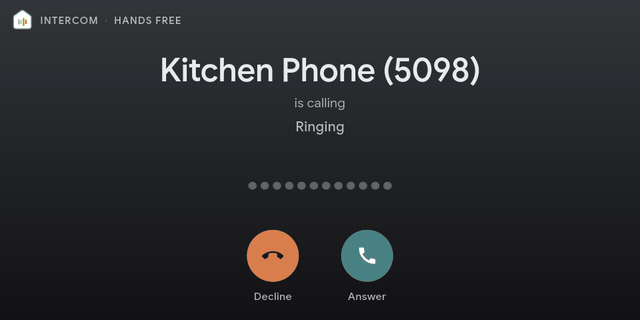
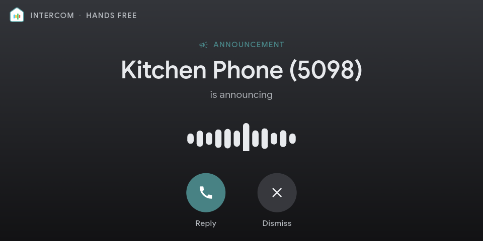

# ☎️ Kiosk Phone  

A [Kiosk Satellite](https://kiosksatellite.com) plugin that turns a kiosk into a SIP phone on your PBX. It rings for calls, and it plays pages and announcements, even when nobody has a dashboard open.

*A call to the kiosk's extension on an Echo Show 5: ringing, answered, ended.*

*A page playing as an announcement.*

## 📞 Features

- 📞 **A real SIP phone:** The kiosk registers as its own extension, so your PBX treats it like any other phone.
- 🔔 **Calls ring the kiosk:** Answer or Decline on the screen, then talk both ways through the kiosk's speaker and microphone, using the native Kiosk Satellite Intercom.
- 📢 **PBX paging and announcements:** Page the extension or a page group in your PBX and the kiosk plays it through Kiosk Satellite's own intercom as an announcement: same chime, same volume, same Do Not Disturb. Dial your PBX's paging or intercom code for the extension, or add it to a page group, and the kiosk answers on its own.
- 🏠 **Status in Home Assistant:** Whether it is registered, the last page, how fast it answered, and the call state show up as Kiosk Satellite entities.

Kiosk Phone doesn't bypass Kiosk Satellite's intercom settings. Audio goes through the intercom, so Do Not Disturb, Lockdown Mode, Accept announcements, the intercom switch, a call already in progress and Maximum call duration all apply as they do for any other intercom call. When the kiosk can't take a page, it stays quiet and the caller is told so.

## 📱 Requirements

| | |
|---|---|
| **You need** | A PBX or SIP provider that speaks standard SIP over UDP, one extension per kiosk, and a kiosk running Kiosk Satellite 2026.10.22 or newer with **Intercom** on (with an intercom key), **Accept announcements** on and Remote Admin on |
| **Tested on** | Echo Show 5 (LineageOS) with FreePBX (Asterisk); G.722, G.711 µ-law and A-law |
| **Should work on** | Other kiosks on Android 7.0 or newer, and other PBXs that follow standard SIP; not tried |

The kiosk must be able to reach the PBX on its SIP port (usually 5060). Outgoing calls from the kiosk are planned, not built.

## 🚀 Install

1. In Kiosk Satellite, open **Settings > Plugin Manager** (or **Plugin Manager** in Remote Admin) and turn on **Enable Plugins**.
2. Choose **Add plugin**, paste `https://github.com/mpjanofsky/kiosk-phone`, and choose **Preview**.
3. Review the manifest and this README, then choose **Trust and install**.
4. Set up the kiosk's extension as described below, then enable **Kiosk Phone** with the switch on its row.

## 🛠️ Set up a kiosk

1. On your PBX, create an extension for the kiosk. Each kiosk needs its own extension and secret.
2. In the plugin's row (on the kiosk or in Remote Admin), fill in the [settings](#-settings): PBX address, extension, password and this kiosk's intercom key.
3. Enable the plugin. The status line should say **Registered**.
4. To test, dial the extension from another phone, or page it or its page group. To undo, turn the plugin off; the kiosk unregisters.

## ⚙️ Settings

Set these on each kiosk, in the plugin's row. Every kiosk needs its own extension, with its own secret. Numbers are typed as text.

| Group | Setting | What to enter | Default |
|---|---|---|---|
| SIP account | **PBX address** | Host name or IP of the PBX | |
| SIP account | **PBX port** | SIP UDP port | `5060` |
| SIP account | **Extension** | This kiosk's extension | |
| SIP account | **Auth user** | Only if the PBX login differs from the extension | empty |
| SIP account | **Password** | The extension's SIP secret | |
| SIP account | **Local SIP port** | UDP port the kiosk listens on | `5070` |
| Kiosk intercom | **Intercom key** | This kiosk's Kiosk Satellite intercom key | |
| Kiosk intercom | **KS admin port** | Kiosk Satellite's admin port | `2324` |
| Kiosk intercom | **Microphone gain** | Boosts the mic for calls, 1 (off) to 30. Some kiosk mics are very quiet. | `8` |

## 🔒 Privacy and security

- **Secrets are masked.** The SIP password and the intercom key use Kiosk Satellite's secret setting type (2026.10.22 or newer), so Plugin Manager and Remote Admin hide them and only let you replace them. Use a dedicated extension and keep the admin port on a trusted network.
- **Nothing leaves your network** except the SIP traffic to your own PBX. The plugin has no analytics and contacts no other service.
- **SIP and audio aren't encrypted** (UDP and RTP). Keep them on your LAN or a VPN.
- **The plugin runs inside Kiosk Satellite** with its permissions, like every plugin. Review the code before you trust it.

## 🧰 Troubleshooting

The status line shows in the plugin's row in Plugin Manager, on the kiosk or in Remote Admin.

| What you see | What to check |
|---|---|
| Status says `Not registered` | PBX address, port, extension and password. Is the kiosk allowed to reach the PBX on that port? |
| Status says `No intercom key configured` | Fill in **Intercom key** with the key from Kiosk Satellite. |
| Registered, but pages are silent | Intercom on? **Accept announcements** on? Kiosk not in Do Not Disturb or Lockdown Mode? Is the key right? |
| The kiosk chimes and shows the page but plays no sound | Try a plain Kiosk Satellite intercom broadcast. If that is silent too, the kiosk's audio is stuck, not the plugin. A reboot fixed it for us. |
| Caller is turned away | Do Not Disturb is on, or Kiosk Satellite's intercom refused the call. Some PBXs (FreePBX included) report Do Not Disturb and busy the same way, so check the plugin's status line to tell them apart. See [docs/pbx.md](docs/pbx.md). |
| The other side can barely hear you on a call | Raise **Microphone gain**. |

## 🙏 Credits

- SIP code adapted from [meiser79/kiosk-satellite-sip-phone](https://github.com/meiser79/kiosk-satellite-sip-phone) (Apache-2.0).
- G.722 codec ported from SpanDSP by Steve Underwood (public domain), via [Asterisk](https://github.com/asterisk/asterisk).
- Plugin build tools and release workflow follow the [Kiosk Satellite plugin template](https://github.com/jxlarrea/kiosk-satellite-plugin-hello-world) (Apache-2.0).

Details are in [NOTICE](NOTICE) and [licenses/](licenses/).

*Not affiliated with or endorsed by the Kiosk Satellite project.*

## 💬 Feedback and contributing

Ideas or problems? Please [open an issue](https://github.com/mpjanofsky/kiosk-phone/issues). For developers: [building and changing it](docs/DEVELOPING.md), the [Kiosk Satellite intercom protocol](docs/protocol.md) as we observed it, and [PBX behavior](docs/pbx.md).

🤖 Built with a lot of help from Claude, who worked with me on most of the design, code, tests and docs.

Code is Apache-2.0 (see [LICENSE](LICENSE) and [NOTICE](NOTICE)).
